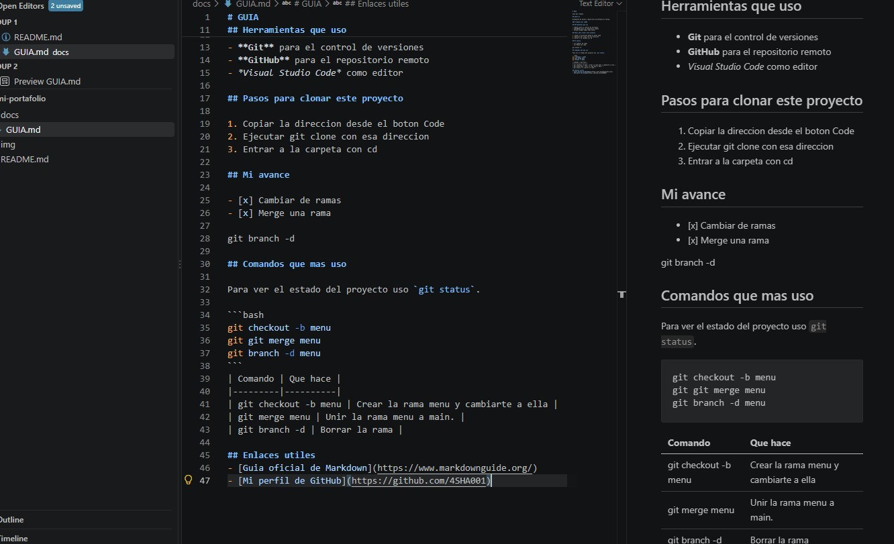

# GUIA

Guia del trabajo

## Sobre mi

Estudiante de Diseno y Desarrollo de Software en Tecsup.

### Trabajos del lab02

## Herramientas que uso

- **Git** para el control de versiones
- **GitHub** para el repositorio remoto
- *Visual Studio Code* como editor

## Pasos para clonar este proyecto

1. Copiar la direccion desde el boton Code
2. Ejecutar git clone con esa direccion
3. Entrar a la carpeta con cd

## Mi avance

- [x] Cambiar de ramas
- [x] Merge una rama

git branch -d

## Comandos que mas uso

Para ver el estado del proyecto uso `git status`.

```bash
git checkout -b menu
git git merge menu
git branch -d menu
```
| Comando | Que hace |
|---------|----------|
| git checkout -b menu | Crear la rama menu y cambiarte a ella |
| git merge menu | Unir la rama menu a main. |
| git branch -d | Borrar la rama |

## Enlaces utiles
- [Guia oficial de Markdown](https://www.markdownguide.org/)
- [Mi perfil de GitHub](https://github.com/4SHA001)

## Captura de mi trabajo
